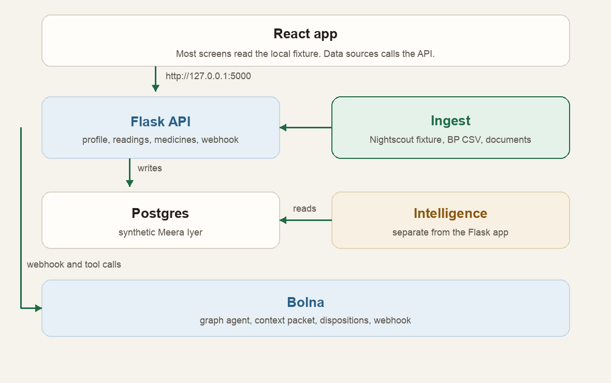

# Care Loop Builderthon demo

Synthetic chart only. Meera Iyer is a fixture. There is no real patient and no paired meter. No phone call was placed.

## Checklist

1. Free TCP port 5000. On this Mac, `curl http://127.0.0.1:5000` returned `403` from `AirTunes`, so Flask was not the listener. The web app calls `http://127.0.0.1:5000` for Data sources.
2. From `backend/`, with the virtualenv active and `DATABASE_URL` set to Postgres:

   ```bash
   psql "$DATABASE_URL" -v ON_ERROR_STOP=1 -f supabase/migrations/0001_init.sql
   psql "$DATABASE_URL" -v ON_ERROR_STOP=1 -f supabase/migrations/0002_ingest.sql
   psql "$DATABASE_URL" -v ON_ERROR_STOP=1 -f supabase/seed/0001_synthetic.sql
   flask --app wsgi run
   ```

   `flask --app wsgi seed` inserts the same patient when the row is absent. If the row already exists, that command sets `preferred_language` to `en` and leaves the existing readings in place. Re-apply `supabase/seed/0001_synthetic.sql` to add any missing seed reading ids.
3. From `web/`:

   ```bash
   npm install
   npm run dev
   ```

   Open [http://127.0.0.1:5173/](http://127.0.0.1:5173/).
4. The screen shows **Meera Iyer**. The API patient id is `11111111-1111-4111-8111-111111111111`. The API `preferred_language` is `en`. Today and Profile still print **Hindi** because those screens read `web/src/data/demo.ts`, which was left unchanged.

`patients.preferred_language` holds one language tag. `hi` and `kn` are accepted by `PATCH /api/v1/patients/<id>` (`backend/tests/test_patients.py`, `test_patch_accepts_hindi_and_kannada`). The Companion language menu also lists Hindi (`hi`), English (`en`), Tamil (`ta`), and Kannada (`kn`). Changing that menu does not write the API.

The only phone on the API patient is the existing synthetic number `+919840011223`.

## What the API seed contains

Verified by `backend/.venv/bin/python -m pytest -q` from `backend/`: **124 passed**, 0 failed (1.43s).

| Item | Value |
| --- | --- |
| Patient | Meera Iyer, `11111111-1111-4111-8111-111111111111` |
| Language | `en` |
| Conditions | type 2 diabetes (2019-06-01), hypertension (2021-02-14) |
| Active medicines | Metformin 500 mg, twice daily, `22222222-2222-4222-8222-222222222222`; Telmisartan 40 mg, once daily, `33333333-3333-4333-8333-333333333333` |
| Consultation | `44444444-4444-4444-8444-444444444444`, Dr. Anika Shah, 2026-11-20 09:30 Asia/Kolkata, status `scheduled` |

Flask seed glucose rows (`mg/dL`, timezone `+05:30`):

| Time | Value | Context | Source |
| --- | --- | --- | --- |
| 2026-11-08 07:05 | 118 | fasting | glucometer |
| 2026-11-10 07:12 | 142 | fasting | manual |
| 2026-11-12 13:40 | 164 | post_meal | cgm |
| 2026-11-13 07:16 | 131 | fasting | glucometer |
| 2026-11-15 07:20 | 125 | fasting | glucometer |

The `cgm` source is a label on a synthetic row. No transmitter is paired.

Flask seed blood pressure (`mmHg`):

| Time | Systolic | Diastolic | Source |
| --- | --- | --- | --- |
| 2026-11-08 08:05 | 132 | 84 | home_monitor |
| 2026-11-11 11:05 | 140 | 88 | clinic |
| 2026-11-15 08:10 | 126 | 80, pulse 71 | home_monitor |

`supabase/seed/0001_synthetic.sql` is the Postgres copy of this chart, plus older rows that were already in that file, adherence logs, and a `voice_calls` row with `bolna_call_id` `demo-call-001` and language `hi`. That row is fixture text. It is not a Bolna execution.

## Walkthrough

Clicked in the browser at `http://127.0.0.1:5173/` on 15 Nov 2026, with the Vite server already running. Flask was not listening on port 5000 during that pass.

### 1. Open Today — WORKING

Click **Today** or open `/`.

The banner says “Synthetic demo data. Not medical advice.” The card shows Meera Iyer, Indiranagar, Bengaluru, preferred language **Hindi**, Type 2 diabetes, and Hypertension. Latest glucose is **125 mg/dL**, fasting, glucometer, 15 Nov 2026, 07:20 am. Latest blood pressure is **126/80 mmHg**, pulse 71, home monitor, 15 Nov 2026, 08:10 am. Next consultation on this screen is **Endocrinology consultation, 24 Nov 2026, 11:00 am**.

Evidence: browser snapshot of `/`. These numbers come from `web/src/data/demo.ts`. The API consultation is 20 Nov 2026, covered by `backend/tests/test_consultations.py`.

### 2. Open Profile — WORKING

Click **Profile**.

The page lists both conditions, penicillin, and preferred language **Hindi** / `hi`. The phone link is the synthetic `+91 98400 11223`.

Evidence: browser snapshot of `/profile`. The API profile is English: `backend/tests/test_patients.py`, `test_get_profile`.

### 3. Open Glucose — WORKING

Click **Glucose**.

The unit field is locked to `mg/dL`. The history starts at “Showing 14 of 14.” Sources in the filter are Manual, CGM, and Glucometer. A gap line names 14 Nov 2026. The chart is the local fixture, including a CGM-labeled point. That label is not a sensor connection.

Evidence: browser snapshot of `/glucose`.

### 4. Save a glucose reading — WORKING

On Glucose, enter a number and a time, then click **Save reading**.

This session used value `121` and time `2026-11-15T09:00`. The page said “Saved in this demo only.” and “Showing 15 of 15.” The form copy says the save stays in this browser session. The Today glucose card is bound to the fixture export in `web/src/pages/dashboard/DashboardPage.tsx`, and a later visit to Today still showed 125 mg/dL. The form does not call `POST /api/v1/patients/<id>/readings/glucose`.

Evidence: browser click on Glucose. The API write is a separate passing test, `backend/tests/test_readings.py`, `test_record_glucose`.

### 5. Open Blood pressure — WORKING

Click **Blood pressure**.

The unit is locked to `mmHg`. The page starts at “Showing 8 of 8.” Sources are Manual, Home monitor, and Clinic. There is no Bluetooth button.

Evidence: browser snapshot of `/blood-pressure`.

### 6. Save a blood pressure reading — WORKING

Enter systolic, diastolic, and a time, then click **Save reading**.

This session used 124, 78, and `2026-11-15T09:05`. The page said “Saved in this demo only.” and “Showing 9 of 9.” The Today blood-pressure card reads the same fixture, and a later visit to Today still showed 126/80. The form does not call the API.

Evidence: browser click on Blood pressure. The API write is `backend/tests/test_readings.py`, `test_record_blood_pressure_with_pulse`.

### 7. Open Data sources — WORKING

Click **Data sources**.

The heading includes patient `11111111-1111-4111-8111-111111111111`. In this session the page settled on “Sync status unavailable” and “Fixture preview, API not connected,” with Synthetic 3 rows, Manual 3 rows, and Device 0 rows. That is the fallback in `web/src/pages/ingest/IngestPage.tsx` when `http://127.0.0.1:5000` does not answer as Flask.

Evidence: browser snapshot of `/ingest`, plus `curl` to port 5000 returning AirTunes `403`.

### 8. Load the Nightscout fixture — WORKING as an API test, failed in this browser

Click **Load demo Nightscout fixture**.

This browser showed “Failed to fetch. Fixture preview stays on this page.” The fixture preview remained. A physical CGM is **SIMULATED**. The mock ingest itself passed in `backend/tests/test_ingest_nightscout.py`, `test_mock_fixture_ingests_synthetic_glucometer_rows`. Run Flask on port 5000 before expecting the button to insert rows.

### 9. Open Medicines — WORKING

Click **Medicines**.

Metformin 500 mg twice daily and Telmisartan 40 mg once daily are listed for 9–15 Nov 2026, with Taken, Missed, and Unknown slots. Vitamin D is on the page and has no rows inside that week. The prescription control says “Demo only, file not stored.”

Evidence: browser snapshot of `/medications`. The API active list is `backend/tests/test_medications.py`, `test_active_medication_schedule`.

### 10. Mark a dose — WORKING

On the Metformin row for 15 Nov 2026, 8:00 pm, click **I've taken it**.

The row changed to Taken and “Recorded as taken.” Clicking **Today** without a reload removed the alert “The Metformin 8:00 pm slot for today is still unrecorded.” A full reload restores the fixture. This button does not call `POST /api/v1/patients/<id>/adherence`.

Evidence: browser clicks on Medicines and Today. The API adherence write is `backend/tests/test_medications.py`, `test_record_adherence_does_not_change_dosage`.

### 11. Open the consultation — WORKING

Click **Calendar**, then **Consultations**.

The week of 9–15 Nov 2026 is empty for that filter. Outside the week, the upcoming consultation on screen is **Endocrinology consultation, 24 Nov 2026, 11:00 am**, Care Loop Clinic, Bengaluru. A past consultation on 20 Oct 2026 is also listed.

Evidence: browser snapshot after clicking Consultations. The API upcoming visit is 20 Nov 2026 with Dr. Anika Shah (`backend/tests/test_consultations.py`). The screen and the API are two different fixtures.

### 12. Open Reports — SIMULATED

Click **Reports**.

The page says storage is not connected and previews are unavailable. **Preview unavailable in demo** is disabled on each placeholder file. Adding a name keeps it on the page only. Automatic medication confirmation from a PDF is simulated. The API can extract text from a synthetic prescription and can record a confirm flag, and that confirm still does not insert a medication (`backend/tests/test_ingest_documents.py`, `test_confirm_does_not_create_medication`). This page does not call that API.

Evidence: browser snapshot of `/reports`, plus the document test above.

### 13. Choose Kannada on Companion — WORKING

Click **Companion**. Open **Language**. The options are Hindi, English, Tamil, and Kannada. Choose **Kannada**.

The voice card updates to “Language for this session: Kannada.” The helper text says this does not place a call. The choice is local state. It does not `PATCH` `preferred_language`.

Evidence: browser select on `/companion`. API acceptance of `hi` and `kn` is `test_patch_accepts_hindi_and_kannada`.

### 14. Start a voice check-in — inbound line shown, no call placed

On a fresh load, **Language** is **English**. The API patient language is `en`. Hindi, English, Tamil, and Kannada stay in the menu. Today and Profile still read Hindi from `web/src/data/demo.ts`. After step 13, the session label is Kannada until reload.

The voice card shows **CareLoop AI Health Companion**, **Call +1 423 583 8428**, and “This number is linked for inbound calls to that agent.” It also says “Chart updates from the call are not live yet.” Click **Start a voice check-in**. The panel repeats that inbound line and the selected language. It does not say that voice is disconnected. The page does not request the microphone and does not place a call. Recent call cards still say “Demo check-in, not a Bolna call.”

The Companion button still does not dial. The outbound path added after this click is in [Outbound reminder](#outbound-reminder). Evidence from the button itself: it does not request the microphone and does not return an execution id.

## Outbound reminder

Checked with the Bolna MCP on 15 Nov 2026. No call was placed, and `get_execution` was not called.

| Check | What the MCP or the local process showed |
| --- | --- |
| Public origin | `https://intelligent-nominations-der-fall.trycloudflare.com`, from `cloudflared tunnel --url http://127.0.0.1:5055`. A context GET through that origin returned 200. |
| Webhook | `get_agent` shows `webhook_url` `https://intelligent-nominations-der-fall.trycloudflare.com/api/v1/bolna/webhook`. It is not null. A localhost URL was not written. |
| Tools | `get_agent` and `get_graph_agent` both show `api_tools` non-null. Each tool uses `key` `custom_task`. `tools_params` carries `method`, `url`, and `param` with `%(name)s` on that public origin. |
| Language | The existing transcriber `language` field is `en`. No synthesizer key was added. `hi` and `kn` stay in `user_data.preferred_language`. |
| Phone | `get_user_info` has no phone field. `list_phone_numbers` failed because `GET /phone-numbers/all` returned an object with keys `bolna` and `user` instead of a list. `USER_PHONE_NUMBER` and `CARELOOP_USER_PHONE` were unset. |
| Call | No outbound execution id. The synthetic `+919840011223` was not dialed. |
| Workflow | `CareLoop daytime reminder`, id `83e20952-59c2-4bd1-909e-42315f052a35`, published version 2 with no warnings. It was not started. |

Flask is on `127.0.0.1:5055` with sqlite `/tmp/care-loop-demo.db` because port 5000 is AirPlay. `POST /api/v1/patients/<id>/bolna/remind` defaults `purpose` to `medication_check` and `to` to `USER_PHONE_NUMBER`. A live post of `+919840011223` returned 400 and named that synthetic chart number. `backend/.venv/bin/python -m pytest -q tests/test_remind.py` reported **5 passed**. Those tests mock `start_outbound_call`, so pytest does not dial.

The graph tools call the public context, medication, history, glucose, blood-pressure, adherence, upcoming-consultation, and care-event routes. Adherence sends `source` `call_self_report`. Urgent symptoms use `post_clinical_escalation` in the same call. The prompts say the speaker is an AI companion, not a clinician, and that it does not diagnose or change medicines.

The workflow agent node uses agent `8ad7201e-2fe5-4595-8a45-35ed60fb1fcd` and variables `purpose` and `patient_id`. On `call.status` `no_answer`, a time node waits until 08:00 Asia/Kolkata when the local hour is before 08:00 or 19:00 or later, and 15 minutes when it is already daytime. A retry node then runs the call once. The workflow was not run, including not against `+919840011223`.

The quick tunnel has no uptime guarantee. The 15 Nov hostname stopped resolving on 16 Nov. The origin above is the replacement, saved on the agent the same day. When this tunnel stops, Bolna cannot reach the webhook or the tools until a new public origin is saved.

## Working, with the evidence above

- Patient profile, English seed language, and `hi` / `kn` patches: `backend/tests/test_patients.py`.
- Conditions, medicines, readings, and the 20 Nov consultation on the API chart: `test_history_returns_the_chart` and `backend/tests/test_consultations.py`.
- Glucose and blood-pressure writes: `backend/tests/test_readings.py`.
- Adherence that refuses a dose change: `backend/tests/test_medications.py`.
- Bolna context packet for `glucose_check`, `bp_check`, `medication_check`, `appointment_reminder`, and `general`: `backend/tests/test_voice.py`, `test_bolna_context_is_an_allow_list`. The packet’s `preferred_language` is `en`. It includes due medicine names and times, latest glucose 125 mg/dL, latest blood pressure 126/80 mmHg, and the next consultation when that visit is still in the future.
- Outbound reminder queue, including rejection of `+919840011223`: `backend/tests/test_remind.py`, **5 passed**. The test mocks the Bolna call.
- Webhook inbox, idempotent on the delivery key, including a body that contains `extracted_data.glucose_reported`: `test_webhook_is_idempotent_and_does_not_write_the_chart`.
- Nightscout mock fixture: `backend/tests/test_ingest_nightscout.py`.
- Blood-pressure CSV and manual ingest: `backend/tests/test_ingest_bp.py`.
- Document text extraction that does not create a medication: `backend/tests/test_ingest_documents.py`.
- Forecast route returning `model: timesfm` and an empty estimate list when the library is missing: `backend/tests/test_ingest_forecast.py`. `runtime_status()` printed `missing` from `backend/.venv/bin/python`.
- Browser screens and the in-session glucose, blood-pressure, and dose controls listed as WORKING above.

The intelligence package was not executed. Flask does not import it. `intelligence/tests` was not part of the pytest command above.

## Simulated

- A completed Bolna phone conversation. The remind endpoint and the published workflow exist. No outbound call was placed, no execution id was returned, and `get_execution` was not called. Step 14 still only shows the inbound line.
- A webhook delivery from Bolna’s cloud. `webhook_url` is set, and this session has not observed a delivery. The inbox test posts from the Flask test client.
- CGM hardware. Seed and fixture rows can carry source `cgm` or a Nightscout replay. No transmitter is paired.
- Bluetooth blood pressure. `backend/tests/test_ingest_bp.py`, `test_bluetooth_is_not_connected`, expects HTTP 501 and the message “Bluetooth blood pressure devices are not connected.”
- TimesFM numeric forecast. The library status on this machine is `missing`. The route stays `available: false` with `estimates: []`. It does not invent numbers.
- GlucoFM. There is no GlucoFM call in the backend. `docs/glucose-forecast.md` records that no public official checkpoint is wired in.
- Automatic medication confirmation from PDFs. Confirming an extraction does not insert a medication. The Reports screen does not store the file.

## Known limitations

- The webhook stores `extracted_data` on the voice-call row. It does not copy extracted readings into the chart. `test_webhook_is_idempotent_and_does_not_write_the_chart` posts a glucose value of 400 mg/dL and asserts the reading count is unchanged.
- The public origin is a Cloudflare quick tunnel, `https://intelligent-nominations-der-fall.trycloudflare.com`. It is not a permanent hostname. `get_agent` shows that origin on `webhook_url`, and `api_tools` is non-null. When the tunnel stops, those URLs stop working until a new public origin is saved. The graph agent is CareLoop AI Health Companion, `8ad7201e-2fe5-4595-8a45-35ed60fb1fcd`.
- There is no call token. A search of `backend/` found no `call_token` minting. The context route is an ordinary `GET` with the patient id in the path.
- Bluetooth returns 501.
- TimesFM is not installed (`runtime_status()` is `missing`).
- GlucoFM has no public checkpoint in this repo.
- Today, Profile, Glucose, Blood pressure, Medicines, Calendar, Reports, and Companion do not read Postgres. Only Data sources calls Flask.
- Today and Profile still show Hindi from the fixture. Companion’s language menu defaults to English, matching the API language `en`. Hindi and Kannada stay selectable.
- The on-screen next consultation is 24 Nov 2026. The API consultation is 20 Nov 2026.
- A reload clears session dose marks and session-only readings.
- Port 5000 may be taken by macOS AirPlay. Data sources then stays on the fixture preview.

## Architecture

<p align="center">
  
</p>

The other React screens read `web/src/data/demo.ts`.

## How Bolna powers Care Loop

Agent creation, inbound linking, transcript extraction tests, the public webhook, and `api_tools` were verified by the Bolna MCP. No outbound call was placed. `get_user_info` has no phone field. `list_phone_numbers` still fails before returning the grouped `bolna` / `user` object, so this session did not read a new E.164 from it. `USER_PHONE_NUMBER` was unset, and the synthetic chart number was not dialed. Details of the earlier inbound link are in [docs/bolna-demo-link.md](docs/bolna-demo-link.md). The current webhook and tools are in [Outbound reminder](#outbound-reminder).

- Graph agent, verified by MCP (`get_graph_agent`): **CareLoop AI Health Companion**, id `8ad7201e-2fe5-4595-8a45-35ed60fb1fcd`. Nodes: `start`, `medication`, `glucose`, `blood_pressure`, `consultation`, `concern`, `escalation`, `close`. Purpose routes on `recipient_data.purpose` (`medication_check`, `glucose_check`, `bp_check`, `appointment_reminder`). `get_agent` shows the existing transcriber `language` is `en`. No synthesizer key was added.
- Inbound link, verified by MCP: `setup_inbound_agent` succeeded earlier for `+14235838428`, phone number id `8820ada7-a2c5-44c5-b658-ea3109b6b702`. `list_phone_numbers` failed because the API returned an object with keys `bolna` and `user` instead of a list. An earlier session read the number from that grouped payload. Step 14 did not receive the payload, and it did not call `setup_inbound_agent` again because `get_agent.inbound_phone_number` was already that id. No number was purchased.
- `user_data` on `POST /api/v1/patients/<id>/bolna/remind` carries `patient_id`, `preferred_language`, `purpose`, and a one-line `reason`. The allow-listed chart packet remains `GET /api/v1/patients/<id>/bolna/context`, which the graph tool calls. That packet was not sent on a live call. It still excludes the chart narrative, allergies, doses, and documents (`backend/tests/test_voice.py`).
- `custom_task` tools are HTTP functions Bolna calls during a conversation. `get_graph_agent` shows them on the public origin: context, medications, history, glucose, blood pressure, adherence with `source` `call_self_report`, the upcoming consultation, `follow_up_task`, and `clinical_escalation`. `patient_id` and `preferred_language` come from `user_data`.
- Dispositions, verified by MCP: `test_dispositions` completed for three synthetic transcripts, which were not phone calls: missed metformin / away from home; fasting glucose 142 mg/dL; chest discomfort escalated. Category `Call outcomes` (`0090ff6d-242b-46d6-bef8-3d85ff2e6064`). Every question in those runs returned `status: completed`. On a real call, answers would arrive inside `extracted_data`. Flask keeps that object on the voice-call row after a webhook post. It does not turn those answers into glucose or blood-pressure rows by itself.
- The webhook is `POST /api/v1/bolna/webhook`. `get_agent` shows `webhook_url` set to the public tunnel plus that path. This session has not observed a delivery from Bolna’s cloud. The same delivery key returns `{"duplicate": true}` and does not insert another voice call. A payload with no resolvable patient returns 202 and stores no clinical row. When `BOLNA_WEBHOOK_SECRET` is set, the request must send it in `X-Care-Loop-Secret`.
