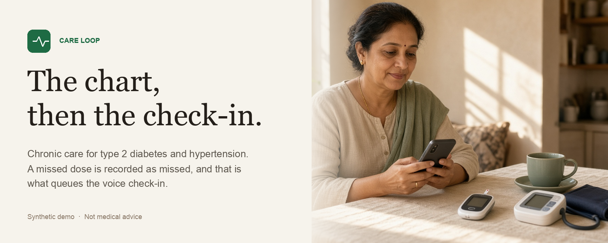
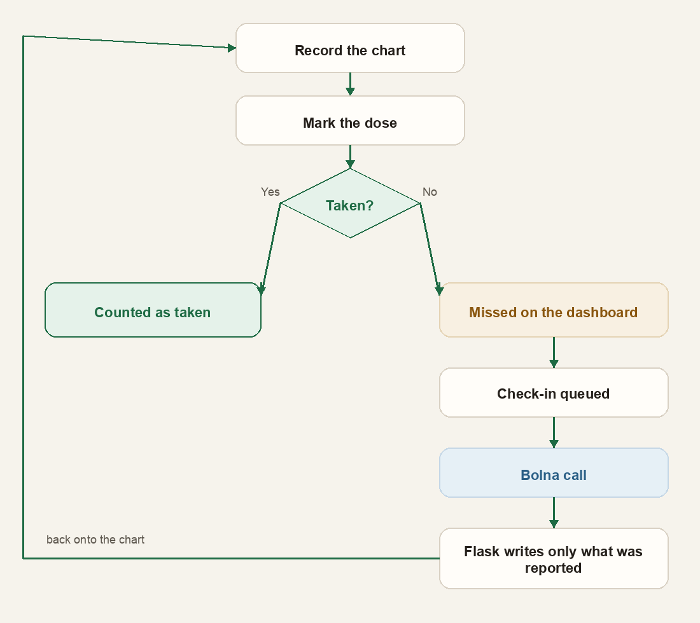
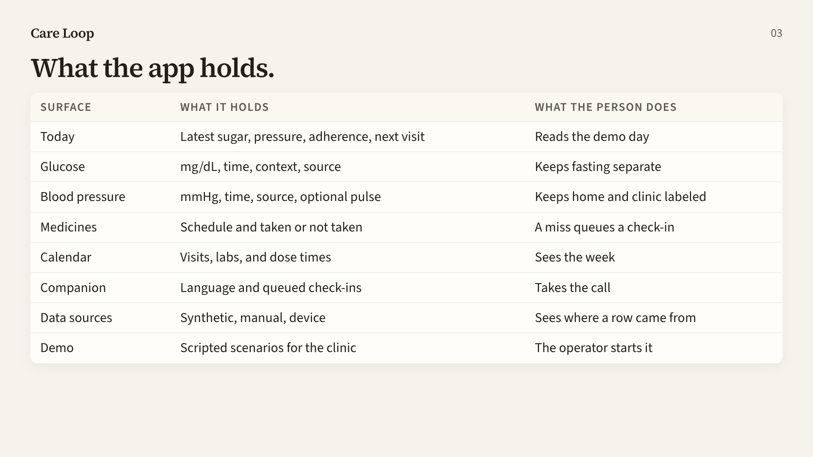
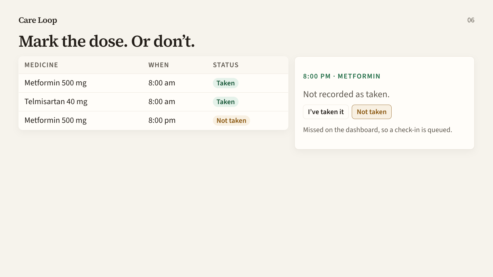
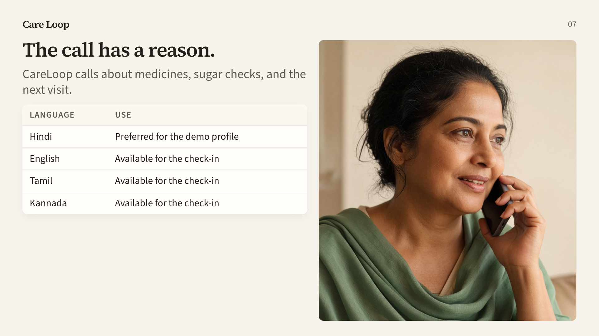
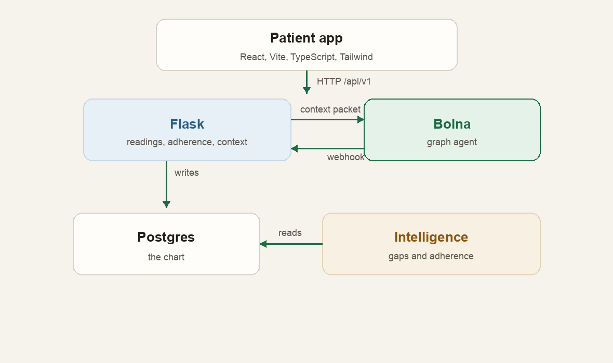

<p align="center">
  
</p>

<p align="center">
  Multilingual chronic care for type 2 diabetes and hypertension.<br />
  The chart is the source of truth. A missed dose is what queues the check-in.
</p>

<p align="center">
  <a href="DEMO.md">Demo walkthrough</a> ·
  <a href="architecture.md">Architecture</a> ·
  <a href="presentation/Care-Loop-deck.pdf">Slide deck (PDF)</a> ·
  <a href="docs/hackathon.md">Hackathon notes</a>
</p>

Care Loop is a patient chart and a voice check-in for two conditions: type 2 diabetes and hypertension. The person sees glucose, blood pressure, medicines, visits, and reports. They mark a dose taken or not taken. A dose left not taken is missed on the dashboard, and that miss is the reason a check-in is queued.

The database holds the chart. Bolna places and understands calls. Neither the browser nor the voice agent writes a diagnosis, a prescription, or a dose change.

Development data is synthetic. Meera Iyer and Ravi Sharma are fixtures. This repository does not contain a real patient record.

## The loop

<p align="center">
  
</p>

| Beat | What happens | What does not happen |
| --- | --- | --- |
| Record | Glucose, pressure, medicines, visits, and language sit on the chart. | A CGM label is not a paired sensor. |
| Mark | The person presses **I've taken it** or **Not taken**. | The app does not change the prescribed dose. |
| Ask | Not taken stays off the taken count and queues a check-in. | The call does not diagnose or prescribe. |

## What you can open

| Surface | Route | What it holds |
| --- | --- | --- |
| Today | `/` | Latest glucose, blood pressure, adherence, next visit |
| Profile | `/profile` | Name, conditions, language, phones |
| Glucose | `/glucose` | mg/dL, time, context, and source |
| Blood pressure | `/blood-pressure` | mmHg, time, source, optional pulse |
| Medicines | `/medications` | Schedule, and taken or not taken |
| Calendar | `/calendar` | Visits, labs, and dose times |
| Reports | `/reports` | Synthetic prescription and lab file names |
| Data sources | `/ingest` | Synthetic, manual, and device rows |
| Companion | `/companion` | Language and queued check-ins |
| Clinic demo | `/demo` | Scripted scenarios. The operator starts them. |

<p align="center">
  
</p>

<p align="center">
  
</p>

<p align="center">
  
</p>

The stills above are frames from the deck in [`presentation/`](presentation/). The PDF is [`presentation/Care-Loop-deck.pdf`](presentation/Care-Loop-deck.pdf). To present the live deck:

```bash
cd presentation
npx hyperframes present --no-open
```

Open the printed URL and press **P**. The same slides are a Remotion composition, `CareLoopDeck`, under `presentation/remotion/`.

## How the pieces fit

<p align="center">
  
</p>

| Piece | Job | Does not |
| --- | --- | --- |
| `web/` | Shows the chart and the dose marks | Hold a database credential |
| `backend/` | Writes readings, adherence, and call context | Place a call by itself |
| `supabase/` | Schema and the synthetic seed | Store a real chart |
| `intelligence/` | Names gaps and coordination priorities | Change a medicine |
| Bolna | Places and understands the check-in | Own the chart |

Readings keep their own time, unit, and source. A fingerstick, a CGM-labeled row, and a typed number are not averaged together. Clinical thresholds are not care rules until a clinician approves a version. The voice packet is small: name, language, why this call is happening, due medicine names and times, the latest readings when they exist, and the next visit.

```text
Record what the patient reports. Do not diagnose, prescribe, or change medicines.
Ask a clinician to review urgent concerns.
```

## Repository map

```text
care-loop/
├── web/                 Patient app
├── backend/             Flask API, tests, seed command
├── intelligence/        Care-gap and adherence rules
├── supabase/            SQL migrations and synthetic seed
├── presentation/        HyperFrames deck, Remotion cut, PDF
├── docs/                Ingest, voice, forecast, and hackathon notes
├── architecture.md      Design record
└── DEMO.md              Click-by-click demo, with WORKING and SIMULATED
```

| Document | Use it for |
| --- | --- |
| [DEMO.md](DEMO.md) | What was clicked, and what is only simulated |
| [architecture.md](architecture.md) | Product boundaries, voice packet, data model |
| [backend/README.md](backend/README.md) | Endpoints, validation, webhook rules |
| [docs/external-ingest.md](docs/external-ingest.md) | Nightscout and reading origin |
| [docs/bolna-languages.md](docs/bolna-languages.md) | Languages the check-in can use |
| [docs/call-extractions.md](docs/call-extractions.md) | Post-call dispositions |
| [docs/knowledge-base.md](docs/knowledge-base.md) | Stable education, not the chart |
| [docs/glucose-forecast.md](docs/glucose-forecast.md) | Forecast limits |
| [docs/hackathon.md](docs/hackathon.md) | Build Out Loud notes |
| [docs/bolna-demo-link.md](docs/bolna-demo-link.md) | The linked agent. Treat account ids as operational |

## Run the patient app

The screens under `web/` render without the API. Their clock is the fixture date in `web/src/data/demo.ts`, not the computer's date.

```bash
cd web
npm install
npm run dev
```

Open [http://127.0.0.1:5173/](http://127.0.0.1:5173/). The banner says the data is synthetic and is not medical advice.

## Run the API

SQLite is for `pytest` only. The running API expects Postgres.

```bash
cd backend
python3 -m venv .venv
source .venv/bin/activate
pip install -r requirements.txt
cp .env.example .env
```

Set `DATABASE_URL` in `.env`. Do not commit that file. From the repository root:

```bash
psql "$DATABASE_URL" -v ON_ERROR_STOP=1 -f supabase/migrations/0001_init.sql
psql "$DATABASE_URL" -v ON_ERROR_STOP=1 -f supabase/migrations/0002_ingest.sql
psql "$DATABASE_URL" -v ON_ERROR_STOP=1 -f supabase/migrations/0003_phone_links.sql
psql "$DATABASE_URL" -v ON_ERROR_STOP=1 -f supabase/seed/0001_synthetic.sql
psql "$DATABASE_URL" -v ON_ERROR_STOP=1 -f supabase/seed/0002_ravi.sql
cd backend
flask --app wsgi run
```

The API listens on `http://127.0.0.1:5000`. On some Macs that port is already taken by AirPlay Receiver. Tests:

```bash
cd backend
pytest
```

The fixture patient on the API is Meera Iyer, `11111111-1111-4111-8111-111111111111`. The clinic demo patient is Ravi Sharma, `a52a0000-0000-4000-8000-000000000052`. Both charts are synthetic.

## What is real, and what is a fixture

| Claim | State |
| --- | --- |
| Patient app screens and the dose tracker | In this repo. The web fixture does not follow the computer's date. |
| Flask chart writes, adherence, and the voice context packet | In this repo, covered by `backend/tests`. |
| Nightscout mock ingest | In this repo. A failed API shows a fixture preview, not a live sensor. |
| Glucose forecast | Documented in `docs/glucose-forecast.md`. TimesFM is not a paired meter. |
| Bolna agent, inbound number, and one answered check-in | Recorded in `docs/bolna-demo-link.md`. This README does not place a call. |
| Bluetooth blood pressure, a public Bolna webhook in production, GlucoFM | Not a finished product path. See [DEMO.md](DEMO.md). |

Data-source labels stay separate:

| Label | Meaning |
| --- | --- |
| Synthetic | Demo chart data |
| Manual | Entered by a person |
| Device | Reported by a connector |

A fixture preview is not a device row.

## Safety

- No real patient chart belongs in this environment.
- `.env` is gitignored. `backend/.env.example` has empty secrets and a local Postgres URL.
- Production refuses Bolna webhooks until `BOLNA_WEBHOOK_SECRET` is set. Clients send it as `X-Care-Loop-Secret`.
- The synthetic chart number and the Care Loop line are rejected as outbound destinations.
- Urgent symptoms collected on a call are for a clinician. The agent does not tell the person what dose to take.

## Design

The app, the deck, and this README share one palette: warm paper `#f6f3ec`, ink `#241f1a`, sage `#1e6b44`, and a muted blue `#2a5f86`. Titles are serif. Numbers are tabular. A wider social card for the GitHub preview is at [`docs/images/social-preview.png`](docs/images/social-preview.png).
